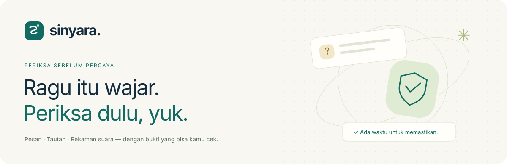
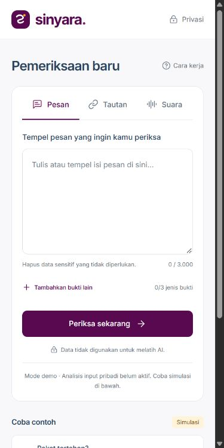
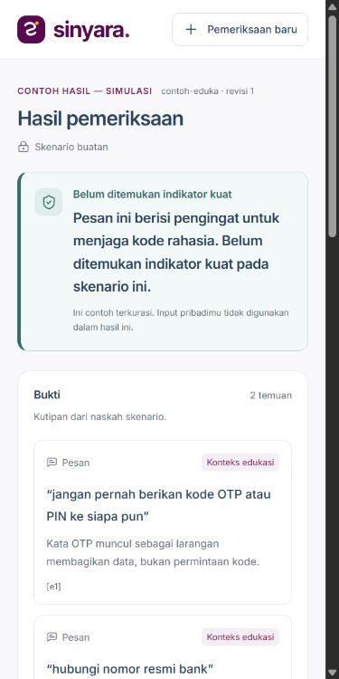
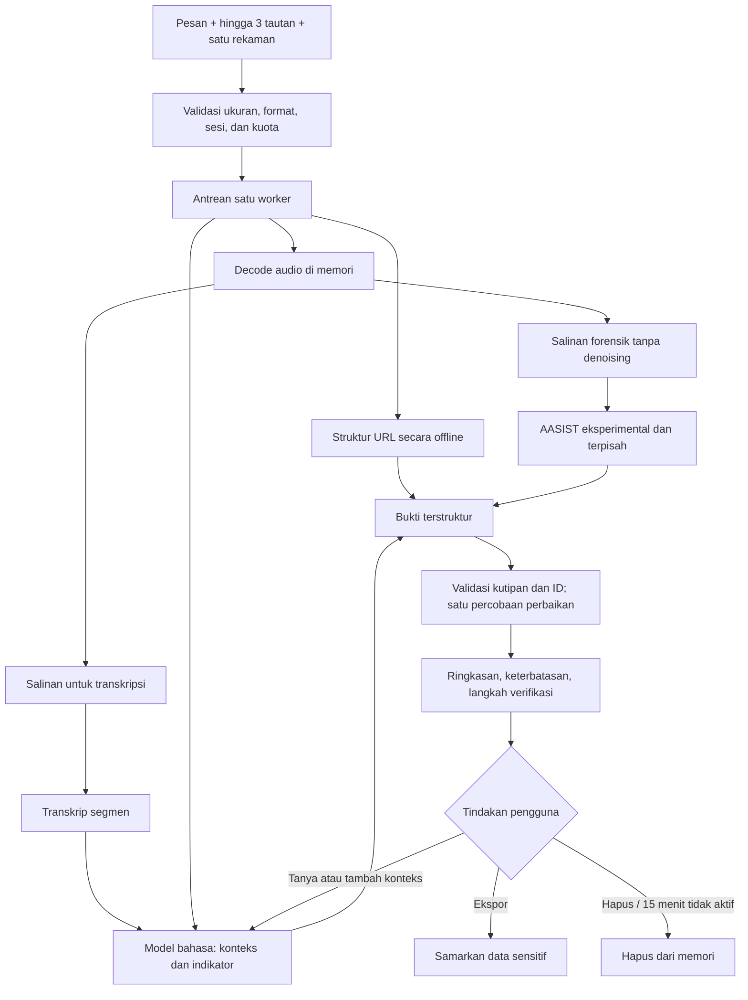

<p align="center"></p>

<p align="center">
  <a href="https://github.com/zeyniaa/sinyara/actions"></a>
  
  
  
</p>

<p align="center"><b>Kenali indikator risiko. Baca buktinya. Ambil waktu untuk memastikan.</b></p>

Sinyara membantu masyarakat dan keluarga memeriksa **pesan, tautan, dan rekaman suara yang mencurigakan**. Satu kasus dapat memuat ketiganya. Hasilnya menjelaskan apa yang ditemukan, bagian mana yang belum diperiksa, dan langkah verifikasi berikutnya.

> **Status v0.1:** frontend memiliki tiga skenario sintetis berlabel **“Contoh hasil — simulasi”**. Backend lokal menjalankan analisis nyata melalui Ollama, pemeriksaan URL tanpa membuka situs, transkripsi CPU, serta AASIST eksperimental. Template backend publik disediakan; aktivasi ZeroGPU menunggu akun Hugging Face yang memenuhi syarat. Tidak ada klaim akurasi produksi atau tingkat keyakinan terkalibrasi.

<p align="center"><a href="https://sinyara.astralcorgi4.chatgpt.site"><b>Coba purwarupa interaktif ↗</b></a> · <a href="docs/architecture.md">Arsitektur & flowchart</a> · <a href="docs/evaluation.md">Catatan evaluasi</a> · <a href="docs/deployment.md">Publikasi</a></p>

## Mengapa Sinyara?

“OTP”, “darurat”, atau suara yang terdengar akrab tidak cukup untuk menyimpulkan penipuan. **“Jangan berikan OTP” adalah peringatan; “kirim OTP sekarang” adalah permintaan data rahasia.** Sinyara memeriksa konteks dan menyertakan kutipan agar pengguna bisa menilai kembali hasilnya.

| Yang kamu berikan | Yang diperiksa | Yang belum bisa dipastikan |
| --- | --- | --- |
| Pesan | Permintaan rahasia/uang, tekanan, penyamaran, kerahasiaan, konteks edukasi | Identitas atau niat sebenarnya dari pengirim |
| Tautan | Domain utama, userinfo `@`, IDN/punycode, subdomain, HTTP, pemendek URL | Isi halaman, tujuan redirect, kepemilikan, dan reputasi eksternal |
| Rekaman | Transkrip segmen serta indikator pada isi percakapan | Transkrip sempurna atau identitas pembicara |
| Karakteristik suara | Inferensi AASIST jika diaktifkan | Kesimpulan manusia/sintetis sebelum kalibrasi Indonesia dan codec |

## Yang sudah dibuat

- **Antarmuka langsung ke pemeriksaan.** Tema terang dengan aksen ungu, formulir tiga tab yang mempertahankan input, unggah/drag audio, navigasi keyboard, dan pengurangan animasi. Tata letak satu kolom pada ponsel; bukti dan chat berdampingan pada desktop.
- **Bukti dalam satu kasus.** Kutipan dapat disorot. Timestamp transkrip memutar bagian rekaman lokal yang sesuai.
- **Percakapan berbasis bukti.** Tanya alasan dan langkah berikutnya. Konteks tambahan meninjau ulang kasus yang sama dan menaikkan nomor revisi.
- **Progres tahap yang nyata.** Antrean, decoding, transkripsi, pemeriksaan isi, dan validasi. Persentase menghitung tahap selesai, bukan menebak waktu tersisa atau keyakinan AI.
- **Kegagalan tetap terlihat.** Model belum tersedia, analisis sebagian, kuota habis, antrean penuh, input rusak, dan kasus kedaluwarsa memiliki respons jelas.
- **Pengelolaan data sementara.** Token kasus, masa simpan 15 menit tidak aktif, hapus kasus, dan ekspor teks dengan nomor/email/tautan disamarkan.
- **Kontrak layanan yang sama.** Adapter FastAPI dan Gradio memakai pipeline dan bentuk hasil yang sama. Tidak ada komponen unggah Gradio yang membuat URL rekaman publik.

### Preview

<p align="center"> </p>

Screenshot menampilkan form dan hasil simulasi dari aplikasi yang berjalan pada lebar 390 piksel. Skenario contoh berisi data buatan; unggahan pribadi tidak menjadi bahan demo.

## Stack dan model

| Lapisan | Implementasi |
| --- | --- |
| Frontend | HTML/CSS, TypeScript, Vite, Inter lokal, ikon Lucide |
| API lokal | FastAPI, Pydantic, HTTPX |
| Penyimpanan | Memori proses, token akses per kasus, tanpa database kasus |
| Antrean | Satu worker FIFO untuk analisis dan percakapan; maksimal 10 pekerjaan menunggu |
| LLM lokal | Ollama; baseline `qwen3:4b`, kandidat `qwen3.5:4b` dapat dipilih lewat `.env` |
| LLM GPU publik | Adapter Transformers untuk `Qwen/Qwen3.5-4B` |
| ASR lokal | `faster-whisper`, multilingual `small`, CPU INT8, VAD |
| ASR publik | `Qwen/Qwen3-ASR-0.6B` di lingkungan/Space terpisah |
| Forensik | AASIST pretrained ASVspoof2019 LA, inferensi CPU, **eksperimental dan belum dikalibrasi** |
| Evaluasi | pytest, Vitest/jsdom, skrip benchmark JSON, MLflow lokal opsional |

Qwen-ASR resmi mematok Transformers 4.57.6, sehingga tidak digabung ke environment Transformers 5.x untuk Qwen3.5. Template dua Space disediakan untuk menghindari konflik ini. Adapter GPU belum diuji pada host ZeroGPU pengguna; lihat batas publikasi di bawah.

## Jalankan di laptop

### 1. Persiapan

Gunakan **Python 3.12**, **Node.js 24**, [uv](https://docs.astral.sh/uv/), dan [Ollama](https://ollama.com/). Untuk model lokal 4B dan Whisper small, laptop dengan RAM 16 GB adalah titik awal pengembangan; waktu respons bergantung perangkat. Tidak memerlukan GPU NVIDIA untuk jalur lokal.

```bash
git clone https://github.com/zeyniaa/sinyara.git
cd sinyara
uv sync --extra audio --extra eval
npm ci
ollama pull qwen3:4b
```

Jika Ollama belum berjalan, jalankan aplikasi Ollama atau `ollama serve`. Tidak perlu menjalankan `serve` lagi jika layanan sudah aktif.

### 2. Konfigurasi

Salin `.env.example` menjadi `.env`, lalu `.env.frontend.example` menjadi `.env.local`.

```dotenv
# .env — backend
SINYARA_LLM_PROVIDER=ollama
SINYARA_LLM_MODEL=qwen3:4b
SINYARA_ASR_PROVIDER=whisper
SINYARA_WHISPER_MODEL=small

# .env.local — frontend development
VITE_BACKEND=fastapi
VITE_API_URL=http://127.0.0.1:8010
```

Untuk membandingkan Qwen3.5 lokal: `ollama pull qwen3.5:4b`, ubah `SINYARA_LLM_MODEL`, lalu restart backend. Hasil aktual setiap run dicatat di `artifacts/`; model terbaru tidak otomatis dianggap lebih baik.

### 3. Siapkan analisis suara

```bash
uv run python scripts/setup_models.py --whisper --aasist --revision a04c9863f63d44471dde8a6abcb3b082b07cd1d1
```

Bobot model masuk cache lokal yang diabaikan Git. Untuk menjalankan AASIST, ubah `SINYARA_AASIST_ENABLED=true` di `.env`. Tanpa pengaktifan, hasil menyatakan bahwa keaslian suara belum diperiksa. Dengan pengaktifan, hasil tetap **belum dapat disimpulkan** sampai kalibrasi yang memadai tersedia. Tidak ada unduhan atau eksekusi kode model saat mengimpor modul Sinyara.

### 4. Nyalakan aplikasi

Terminal pertama:

```bash
uv run uvicorn sinyara.api:app --host 127.0.0.1 --port 8010 --no-access-log
```

Terminal kedua:

```bash
npm run dev
```

Buka **http://127.0.0.1:5174**. Kontrak REST interaktif tersedia di **http://127.0.0.1:8010/docs**.

Di Windows, sesudah dependency terpasang, `powershell -File scripts/start-local.ps1` menyalakan keduanya dan menghentikan API milik skrip ketika frontend ditutup. Tambahkan `-Install` untuk pemasangan awal. Model masih perlu diunduh melalui langkah di atas.

**Hanya ingin melihat HTML?** Jalankan `npm ci` lalu `npm run dev` tanpa `.env.local`. Input pribadi tidak dianalisis; tiga contoh tetap bisa dicoba. Build produksi bawaan menggunakan `.env.production` dan selalu mulai dalam mode simulasi.

## Alur dari input sampai jawaban



Label hasil: **risiko tinggi**, **perlu verifikasi**, **belum ditemukan indikator kuat**, atau **bukti belum cukup**. Label rendah tidak berarti “aman”. Sinyara tidak menampilkan persentase keyakinan yang belum dikalibrasi.

## Kontrak API

| Operasi | FastAPI | Gradio `dispatch` |
| --- | --- | --- |
| Buat kasus | `POST /v1/cases` + `X-Sinyara-Session` | `createCase` |
| Mulai/progres | `POST /v1/cases/{id}/analyze`, lalu `GET /v1/cases/{id}` | `analyzeCase`, stream snapshot |
| Tanya/konteks | `POST /v1/cases/{id}/followups` | `askFollowup` |
| Hapus | `DELETE /v1/cases/{id}` | `deleteCase` |

Operasi kasus memakai header `Authorization: Bearer <token>`; Gradio menaruh token dalam payload, bukan URL. `CaseInput.audio` memuat nama dan base64; isi file tetap diverifikasi decoder. Bentuk hasil mencakup mode, label risiko, bukti, status per pemeriksaan, keterbatasan, langkah berikutnya, versi model, serta revisi. Lihat [contoh integrasi](docs/api.md).

## Batas demo dan privasi

| Batas | Nilai |
| --- | --- |
| Pesan | 3.000 karakter |
| Tautan | Maksimal 3, HTTP/HTTPS, 2.048 karakter per tautan |
| Audio | Satu file, maksimal 60 detik dan 10 MB; WAV/MP3/M4A/OGG/OPUS |
| Analisis | 3 per sesi per 24 jam |
| Percakapan | Maksimal 5 pertanyaan/kasus, termasuk peninjauan konteks |
| Masa simpan | 15 menit tidak aktif; polling tidak memperpanjang |
| Antrean | Satu pekerjaan berat aktif, maksimal 10 menunggu |

Kasus disimpan dalam memori proses dan hilang ketika server dimulai ulang. Tidak ada akun atau riwayat permanen. Audio diputar dari object URL browser dan tidak mendapat URL unduhan publik. Token tidak masuk URL atau penyimpanan permanen browser. Log aplikasi tidak menyimpan pesan/transkrip. Data pengguna tidak otomatis dipakai melatih model.

Kuota berbasis sesi **bukan pencegahan penyalahgunaan yang kuat**: mengganti sesi atau restart server dapat meresetnya. Tambahkan pembatas di gateway dan kebijakan provider sebelum peluncuran luas. Gunakan satu proses backend; beberapa worker proses akan memiliki penyimpanan kasus yang berbeda. Detail ancaman dan penghapusan ada di [privacy & security](docs/privacy.md).

## Uji dan reproduksi evaluasi

```bash
uv run pytest
npm test
npm run build

# Model nyata, data pesan sintetis, bukan ukuran akurasi populasi:
uv run --extra eval python scripts/benchmark.py --mlflow

# Smoke model suara, tanpa klaim akurasi bahasa atau forensik:
uv run --extra audio python scripts/smoke_audio.py

# Dataset rekaman berlabel dan berizin milik pengembang:
uv run --extra audio python scripts/evaluate_audio.py path/to/manifest.csv
```

Unit dan integration test memakai model pengganti agar CI tidak mengunduh model atau memerlukan GPU. Benchmark Ollama nyata berjalan terpisah. [Laporan evaluasi](docs/evaluation.md) membedakan pengujian perangkat lunak, regresi sintetis, pengujian transkripsi, dan evaluasi forensik yang masih diperlukan. Kutipan yang cocok tidak otomatis membuktikan penjelasan model benar; penilaian dukungan semantik memerlukan review manusia.

## Struktur project

```text
sinyara/
├── src/                  # UI, kontrak TypeScript, adapter FastAPI/Gradio, fixtures
├── backend/sinyara/      # API, case service, pipeline, LLM, URL, audio, metrik
├── tests/python/         # Isolasi kasus, antrean, model gagal, audio, kontrak, metrik
├── tests/ui/             # Validasi, escaping, simulasi, perpindahan tab, percakapan
├── scripts/              # Setup model, launcher Windows, benchmark dan evaluasi audio
├── deploy/               # Template ZeroGPU utama + worker ASR terisolasi
├── eval/                 # Pesan sintetis dan template manifest/review
├── artifacts/            # Hasil eksperimen yang boleh dibagikan; private/ diabaikan
└── docs/                 # Flowchart, API, privasi, evaluasi, publikasi, screenshot
```

## Publikasi dan pengembangan berikutnya

Frontend statis dapat dipublikasikan tanpa menjalankan model AI di browser. Backend GPU menargetkan **Gradio ZeroGPU** setelah kelayakan akun diperiksa. Tidak ada akun Hugging Face terautentikasi yang tersedia selama implementasi awal; backend GPU belum dipublikasikan. Lihat [panduan dua Space](docs/deployment.md), termasuk kuota provider yang dapat lebih ketat daripada kuota aplikasi.

Tahap berikutnya: dataset Indonesia berizin dengan anotasi ganda, evaluasi suara manusia/sintetis yang memisahkan speaker dan generator, adapter reputasi dengan lisensi yang sesuai, kalibrasi dan abstention, lalu uji pengguna keluarga. IndoBERT baru dilatih setelah dataset berlabel memadai. Panggilan langsung, pembacaan WhatsApp otomatis, identifikasi pembicara, akun keluarga, dan Android native berada di luar v0.1.

## Referensi dan atribusi

- [Qwen3.5-4B](https://huggingface.co/Qwen/Qwen3.5-4B) — kandidat model publik; kemampuan umum model bukan bukti akurasi penipuan Indonesia.
- [Qwen3-ASR](https://github.com/QwenLM/Qwen3-ASR) — dukungan Indonesia dan dependensi resmi; timestamp Indonesia memakai rentang segmen, bukan forced alignment per kata.
- [faster-whisper](https://github.com/SYSTRAN/faster-whisper) — transkripsi multilingual CPU INT8, lisensi MIT.
- [AASIST](https://github.com/clovaai/aasist) — kode/checkpoint resmi, NAVER Corp., lisensi MIT; skor kelas 1 mengikuti evaluasi resminya. Provenance disimpan oleh skrip setup.
- [ASVspoof](https://www.asvspoof.org/) — acuan evaluasi spoofing dan perbedaan kondisi/codec.
- [IndoBERT](https://huggingface.co/indobenchmark/indobert-base-p1) — kandidat baseline fine-tuning berikutnya.
- [ZeroGPU](https://huggingface.co/docs/hub/en/spaces-zerogpu), [Gradio JS client](https://github.com/gradio-app/gradio/tree/main/client/js), [Ollama](https://docs.ollama.com/) — acuan integrasi.
- [Inter](https://github.com/rsms/inter), [Lucide](https://lucide.dev/license) — aset antarmuka dengan lisensi masing-masing. Font disajikan dari build lokal.

Kode aplikasi berlisensi [MIT](LICENSE). Model, dataset, font, dan ikon mengikuti lisensinya masing-masing. Nama Sinyara adalah nama kerja; merek dan domain perlu diperiksa sebelum peluncuran komersial.
