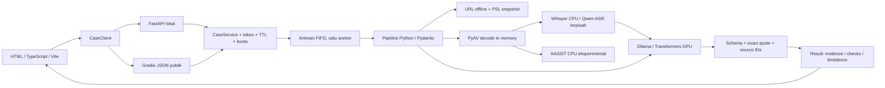

# Arsitektur Sinyara

Sinyara memisahkan pemeriksaan bukti, penyusunan penilaian, dan penyajian hasil. Frontend tidak memiliki logika yang menganggap input pribadi sebagai skenario contoh.

## Siklus kasus

1. `createCase` memvalidasi batas input, struktur URL, format audio, dan kapasitas memori. Token acak dibuat dengan `secrets.token_urlsafe` dan diperlukan untuk semua operasi berikutnya.
2. `analyzeCase` memesan tempat antrean dan kuota secara atomik. Pemanggilan berulang saat masih diproses atau sudah selesai mengembalikan status yang sama dan tidak memakan kuota baru.
3. Satu worker FIFO menjalankan analisis dan pertanyaan lanjutan. Memilih contoh di UI tidak masuk worker atau mengirim unggahan pengguna.
4. Hasil setiap pemeriksaan memuat status sendiri. Kegagalan LLM tidak menghilangkan pemeriksaan struktur URL yang selesai. Kegagalan transkripsi tetap dapat menghasilkan hasil isi pesan yang diberikan secara terpisah.
5. Konteks baru dalam pertanyaan memicu evaluasi ulang input dan seluruh konteks kasus. Hasil memiliki `revision` baru. Ini menghabiskan satu dari lima jatah pertanyaan, bukan menciptakan kasus baru.
6. `deleteCase` menghapus objek kasus dan pekerjaan yang belum dimulai. Hasil pekerjaan yang sedang berjalan tidak dapat menghidupkan kasus yang sudah dihapus. Salinan kerja dilepas setelah panggilan model selesai.
7. Pembersihan TTL berjalan saat permintaan dan pada worker idle. Polling tidak menyentuh aktivitas kasus; interaksi pengguna melalui analisis/pertanyaan memperbaruinya. Semua kasus hilang saat server restart.

## Kebenaran progres

`completed/total` menghitung tahap yang selesai, bukan waktu eksekusi. Kasus tanpa audio mempunyai tiga tahap (URL, isi, validasi); kasus dengan audio menambah decode, transkripsi, dan forensik. Tahap yang berakhir gagal tetap dihitung sebagai selesai dan status kegagalannya masuk hasil. Antrean tidak memiliki persentase karena jumlah pekerjaan di depan pengguna dapat berubah.

Tidak ada estimasi waktu tersisa, skor risiko numerik, atau persentase keyakinan yang dihasilkan lewat animasi. Skenario contoh memang memakai jeda buatan, dengan label simulasi pada halaman pemrosesan dan hasil.

## Batas model bahasa

Ollama memakai mode structured output dan dynamic enum ID sumber. Prompt sistem menegaskan bahwa pesan, pertanyaan, dan transkrip merupakan data tidak tepercaya. Tidak ada tool browsing, eksekusi shell, atau akses berkas bagi model.

Temuan harus merujuk ID yang tersedia, memuat kutipan persis dari sumber, dan mengikuti skema. Risiko tinggi/verifikasi membutuhkan setidaknya satu temuan selain konteks edukasi. Jawaban lanjutan mengelompokkan klaim dengan referensi masing-masing; ID dibatasi dalam skema generasi. Guard keabsahan domain dan pemeriksaan dukungan klaim terpisah menolak penjelasan yang melebihi bukti. Satu percobaan perbaikan diizinkan; sesudah itu hasil dibatasi secara eksplisit.

Pemeriksaan ini mendeteksi referensi palsu, kutipan yang berubah, dan sebagian klaim yang tidak didukung. **Pemeriksaan dukungan oleh model yang sama tetap bisa salah.** Dukungan semantik penjelasan tidak dapat dijamin hanya dengan skema atau self-check; review manusia menjadi bagian evaluasi. Ringkasan utama memakai template berdasarkan label, sehingga tidak menambah fakta dunia luar.

## Suara

Decoder PyAV memeriksa isi file dan durasi ketika decoding, bukan hanya ekstensi atau metadata header. Audio di-resample menjadi mono 16 kHz. Original base64 tetap tersedia di memori kasus sampai dihapus. ASR dan forensik mendapat salinan waveform yang independen. Tidak ada denoising dalam jalur forensik.

Whisper menghasilkan timestamp segmen. Qwen-ASR terisolasi memakai chunk hingga 15 detik; timestamp menunjukkan chunk tersebut. ForcedAligner Qwen yang resmi tidak diasumsikan mendukung Indonesia. Silence gate menghindari inferensi ucapan pada sampel nyaris senyap, tetapi tidak menjamin semua audio tanpa ucapan akan dikenali sempurna.

AASIST memakai checkpoint resmi pada window 64.600 sampel dengan pengulangan padding sesuai pendekatan aslinya. Skor kelas 1 adalah skor bona fide mentah. Tidak dikonversi menjadi probabilitas. Produk tidak menerapkan threshold publik. Angka mentah hanya tersedia dari skrip eksperimen, bukan UI pengguna.

## Jalur publik

Frontend statis tetap ringan. Dua template Gradio menyediakan model bahasa dan ASR terisolasi. Qwen3.5 dimuat saat startup pada host GPU dan panggilan inference dibungkus `spaces.GPU`. Context variables Gradio diteruskan ke worker aplikasi. Stream `dispatch` tetap terbuka selama analisis agar progres dan konteks permintaan tetap tersedia.

Perilaku ZeroGPU, kuota per pengunjung, dua Space, dan cold start belum dapat diverifikasi tanpa host yang memenuhi syarat. Template adalah integrasi yang perlu diuji pada provider, bukan backend publik yang sudah aktif. UI publik bawaan tetap simulasi sampai konfigurasi backend sengaja diubah.
